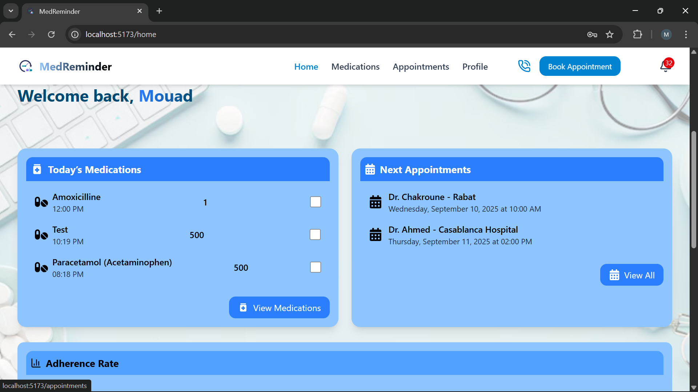
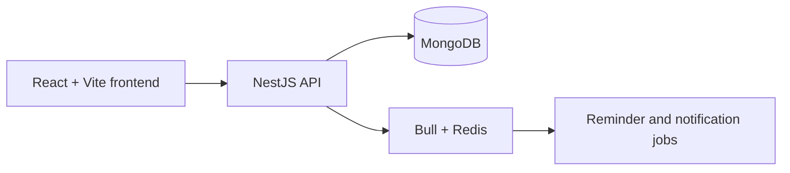
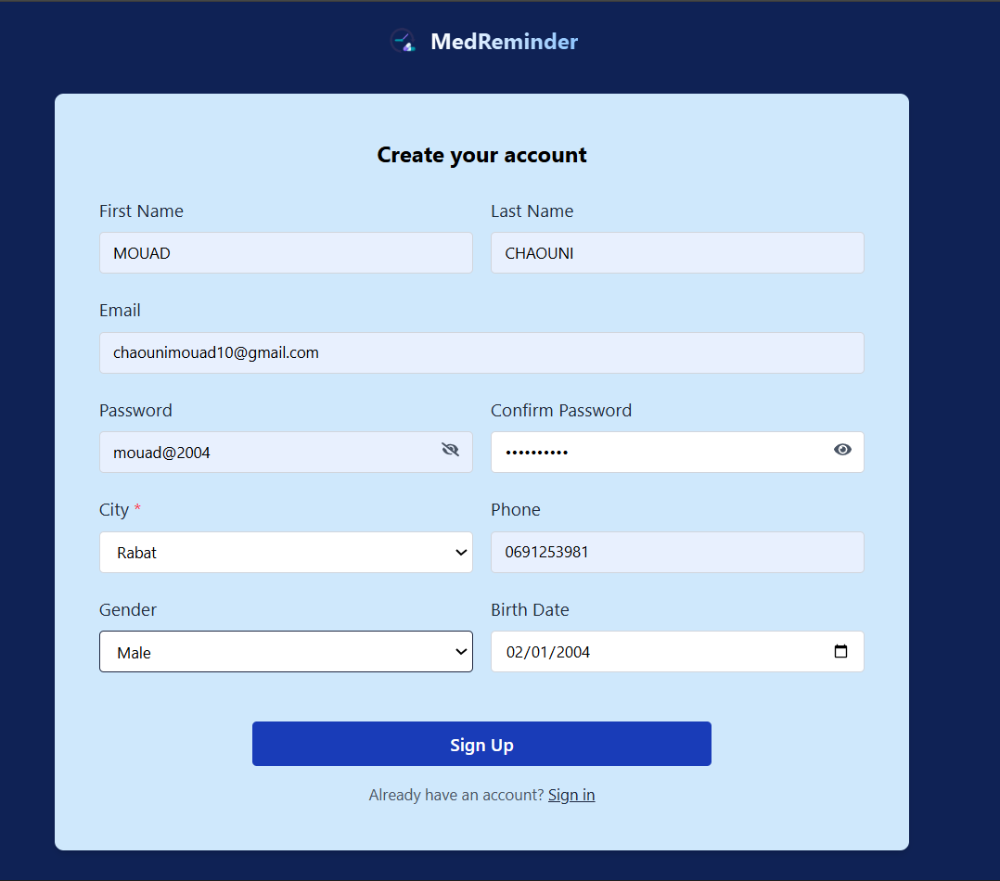
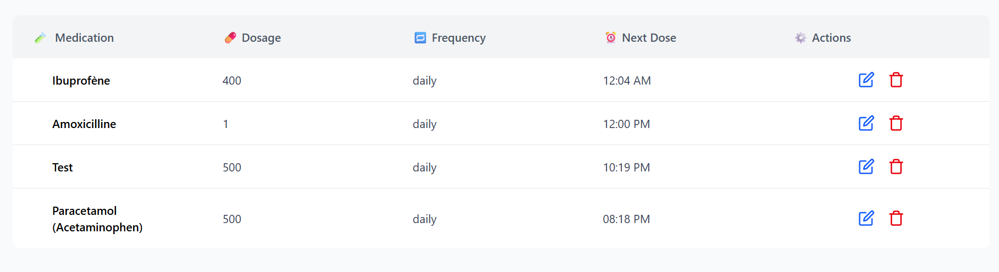
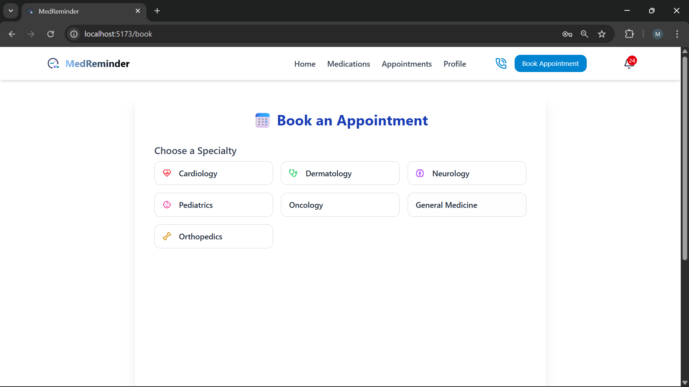

# MedReminder — medication and appointment management

MedReminder is a full-stack healthcare-management project for recording medications, tracking appointments, and surfacing reminders in a personal dashboard. It is a portfolio application; it is not presented as clinical software or as a substitute for medical advice.

<p align="center">
  
</p>

## What the project demonstrates

- JWT-based user authentication and profile management.
- Medication records with dosage, frequency, and intake schedules.
- Appointment discovery and status tracking.
- In-app and email-notification workflows, with background jobs backed by Bull and Redis.
- A React/Tailwind frontend paired with a NestJS API and MongoDB.

## Architecture



## Technology stack

| Area | Technologies |
| --- | --- |
| Frontend | React, Vite, Tailwind CSS, React Router, Axios |
| Backend | NestJS, JWT, Passport, Socket.IO |
| Data and jobs | MongoDB, Prisma, Bull, Redis |
| Local environment | Docker and Docker Compose |

## Repository layout

```text
med-reminder-frontend/   React client
med-reminder-backend/    NestJS API and local Compose configuration
screenshots/             checked-in UI evidence
```

## Screens

| Sign up | Medication list |
| --- | --- |
|  |  |

| Appointment booking | Dashboard |
| --- | --- |
|  |  |

## Local setup

Prerequisites: Node.js 18+, Docker Desktop, and the services/configuration required by the backend environment.

```bash
git clone https://github.com/Mouad852/MedReminder.git
cd MedReminder

cd med-reminder-backend
npm install
npx prisma generate
npx prisma migrate dev

cd ../med-reminder-frontend
npm install
```

Start the backend's local Compose environment from `med-reminder-backend/`:

```bash
docker compose up --build
```

For host-based development, run the API and client in separate terminals:

```bash
# Terminal 1
cd med-reminder-backend
npm run start:dev

# Terminal 2
cd med-reminder-frontend
npm run dev
```

The project historically documents the frontend on `http://localhost:5173` and the API on `http://localhost:3000`; verify environment variables and actual port mappings in the relevant package or Compose configuration before use.

## Demo and scope

[Watch the recorded walkthrough on YouTube](https://youtu.be/sdr5R-KdctQ).

The repository includes screenshots and setup material, but it does not include a public production-deployment claim or a documented automated test suite at the root. Treat the README as a guide to the checked-in project, not evidence of a hosted healthcare service.

## Future work

Ideas retained from the original project notes include mobile clients, family sharing, telemedicine integrations, provider analytics, multilingual support, and voice-activated reminders.
